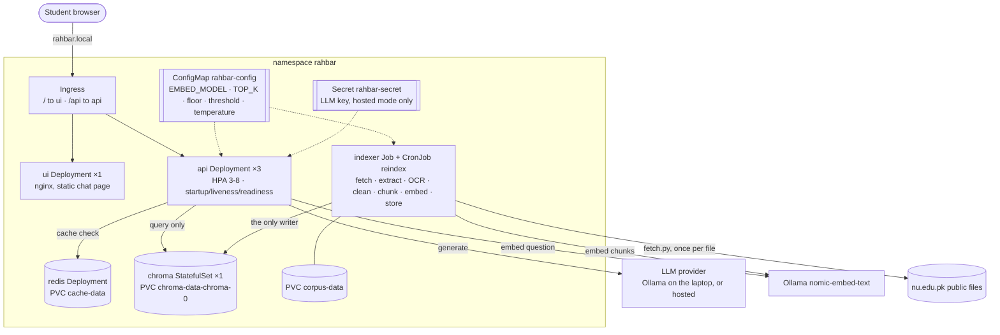

# Architecture

One writer, one reader, one shared pin. The indexer Job is the only thing that writes
the vector store; the api only reads it; both read `EMBED_MODEL` from one ConfigMap.

## Objects (k8s/base)

| Object | File | Notes |
| --- | --- | --- |
| Namespace `rahbar` | `namespace.yaml` | `kustomization.yaml` sets `namespace: rahbar` on everything |
| Deployment `api` ×3 | `api.yaml` | `maxSurge: 1`, `maxUnavailable: 0`, preStop `sleep 10`, grace 360 s (longer than one answer), three probes |
| HPA `api` | `api.yaml` | `autoscaling/v2`, CPU 70% of requests, min 3, max 8 |
| Deployment `ui` | `ui.yaml` | nginx-unprivileged on 8080, emptyDir on `/tmp` |
| StatefulSet `chroma` ×1 | `chroma-statefulset.yaml` | `chromadb/chroma:1.0.12`, `volumeClaimTemplates` → 1Gi |
| Deployment + PVC `redis` | `redis.yaml` | append-only persistence, `strategy: Recreate` |
| Job `indexer` + PVC `corpus-data` | `indexer-job.yaml` | `restartPolicy: OnFailure`, `backoffLimit: 2`, initContainer fetches the corpus |
| CronJob `reindex` | `reindex-cronjob.yaml` | weekly, same pod template, `concurrencyPolicy: Forbid` |
| Services ×4 | `services.yaml` | all ClusterIP: api, ui, chroma, redis |
| Ingress | `ingress.yaml` | host `rahbar.local`, `/api` → api:8000, `/` → ui:8080 |
| ConfigMap | `configmap.yaml` | every tunable, each with a one-line reason |
| NetworkPolicy ×7 | `networkpolicy.yaml` | deny by default, then the paths below |
| ServiceAccount ×5 | `serviceaccounts.yaml` | one per workload, no token mounted |

## Why Chroma is a StatefulSet, not a Deployment

Chroma keeps its data (a SQLite file and HNSW index segments) on a ReadWriteOnce volume,
and it must have exactly one process writing that directory.

- **Stable identity and its own volume.** `volumeClaimTemplates` creates the claim
  `chroma-data-chroma-0` for the pod `chroma-0`. If the pod is deleted or rescheduled,
  the new `chroma-0` gets the same claim back, so the index survives (we demonstrate
  this by deleting the pod). A Deployment's pod has a random name, and its claim has to
  be managed by hand, outside the workload.
- **No overlap during updates.** A Deployment's rolling update starts the new pod
  before it stops the old one. With an RWO volume, the new pod either hangs on the
  attach, or (on a single node, where RWO does not stop it) gets two Chroma
  processes writing one SQLite/HNSW directory. A StatefulSet with one replica stops
  `chroma-0` before it starts its replacement.
- **Ordered, predictable start.** It is a database, and it should behave like one: one
  pod, one name (`chroma-0`), one volume.

## Network paths (k8s/base/networkpolicy.yaml)

| From | To | Port | Why |
| --- | --- | --- | --- |
| ingress-nginx | ui | 8080 | serve the chat page |
| ingress-nginx, ui | api | 8000 | `/api/ask` (the browser calls it through the Ingress) |
| api, indexer | chroma | 8000 | read (api) and write (indexer) the index |
| api | redis | 6379 | semantic cache |
| api, indexer | outside | 11434 / 443 | Ollama on the laptop, or a hosted LLM |
| indexer | outside | 80 / 443 | `fetch.py` downloads the public documents |
| every pod | kube-dns | 53 | without this, default-deny egress breaks every Service name |

Everything else is denied: the ui cannot reach chroma or redis, and nothing can reach
the indexer. Policies are enforced only with a CNI that supports them, which is why
the cluster starts with `--cni=calico`.

## Security: five holes, five closures (section 4.7)

| Hole | Closure here |
| --- | --- |
| Secrets in Git | `*secret*.yaml` gitignored; only `k8s/base/secret.placeholder.yaml` (value `REPLACE_ME`, not in kustomization) is committed; the real Secret comes from `kubectl create secret ... --from-literal` |
| Everything is admin | One ServiceAccount per workload with `automountServiceAccountToken: false`, and no Roles at all |
| Containers as root | `runAsNonRoot: true` with a fixed uid, `readOnlyRootFilesystem: true`, `capabilities: drop: [ALL]`, `allowPrivilegeEscalation: false`, seccomp `RuntimeDefault`, on every container including the Job |
| Flat network | The NetworkPolicies above |
| Unsafe model output | Output constrained to the `Answer` JSON schema and validated by Pydantic. Citations are checked against the retrieved passages. Retrieved text is delimited as data. Nothing from a model or a document is ever passed to `eval`, a shell or SQL. |
