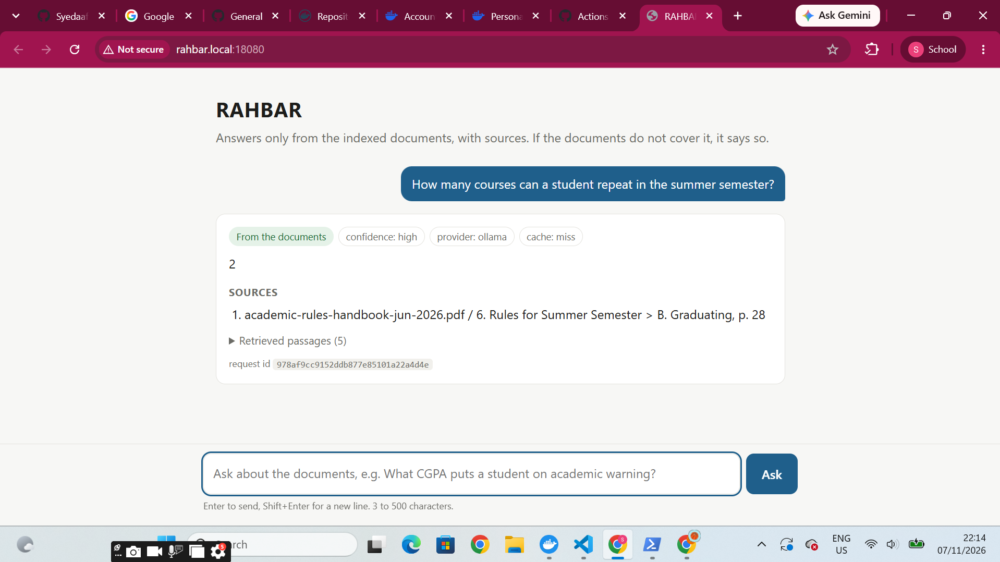
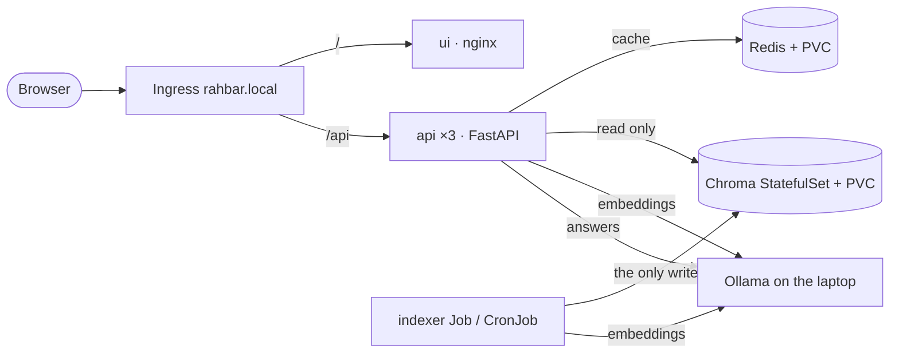

# RAHBAR: grounded answers about FAST-NUCES rules, on Kubernetes

[](https://github.com/Syedaafnan/rahbar_A02/actions/workflows/ci.yml)
[](https://github.com/Syedaafnan/rahbar_A02/actions/workflows/cd.yml)

A student wants to know whether they can register for a course after failing its
prerequisite, or when the last day to withdraw is. The answer is in a PDF on the
university website, and so is last year's superseded version. A general chatbot answers
confidently from some other university's rules. **RAHBAR answers only from the
FAST-NUCES documents it has indexed.** Every answer cites the document and section it
came from, old versions are filtered out unless you ask for them, and when the documents
do not cover a question (hostel rules, on purpose), it says so instead of guessing.



## How it fits together



- **indexer** (`indexer/`): a Kubernetes **Job**. It downloads the documents listed in
  `corpus/sources.yaml`, extracts text (OCR for scanned pages), cleans it, chunks it by
  section, embeds it with `nomic-embed-text`, and writes it to Chroma. Then it exits.
  Why a Job: [ADR 0001](docs/adr/0001-indexer-as-job.md).
- **api** (`api/`): FastAPI. It embeds the question, retrieves the top 5 current
  passages, abstains if nothing is relevant enough, asks the LLM for a JSON answer with
  citations, checks every citation, and caches safe answers in Redis.
- **ui** (`ui/`): one static chat page served by nginx.

More: [architecture](ARCHITECTURE.md) · [corpus](docs/CORPUS.md) ·
[pipeline and measurements](docs/PIPELINE.md) · [failure analysis](docs/FAILURE-ANALYSIS.md) ·
[engineering notes](docs/ENGINEERING-NOTES.md) · [AI usage](docs/AI-USAGE.md)

## From a clean clone to an answered question

You need Docker Desktop (running), `kubectl`, `minikube`, `make`, Ollama, and Python
3.12. On Windows run the commands in **Git Bash**; `winget install Kubernetes.minikube
Ollama.Ollama ezwinports.make` installs the missing tools.

**1. Ollama on your laptop.** It must listen on all interfaces so the cluster can reach it.

```bash
# Windows: setx OLLAMA_HOST 0.0.0.0, then restart Ollama from the Start menu
OLLAMA_HOST=0.0.0.0 ollama serve        # macOS / Linux
ollama pull nomic-embed-text            # embeddings (the pinned EMBED_MODEL)
ollama pull llama3.2:3b                 # answers
```

We generate through `ollama-host` **and embed through the same host**: the indexer Job
and the api both call Ollama on the laptop (`host.minikube.internal:11434`) for
`nomic-embed-text` vectors, and the api calls it for `llama3.2:3b` answers. The
embedding model is pinned by `EMBED_MODEL` in the ConfigMap, which both read.

**2. Start the cluster** with Calico, because the default network plugin silently
ignores NetworkPolicies.

```bash
minikube start --driver=docker --cni=calico --memory=5120 --cpus=4
minikube addons enable metrics-server
minikube addons enable ingress
```

**3. Build the three images and load them into minikube.**

```bash
make images            # docker build api, ui, indexer (tag :dev) + minikube image load
```

Without make, per image (shown for api; the indexer build also needs
`--build-context corpus=corpus --build-context fixtures=eval/fixtures`):
`docker build -t rahbar-api:dev api && docker save --platform linux/amd64 -o api.tar rahbar-api:dev && minikube image load api.tar`.
Load the saved tarball, not the image name: with Docker Desktop's containerd store,
loading by name gave us "exec format error" pods.

**4. Apply everything, in this order:**

```bash
kubectl apply -k k8s/overlays/dev
```

Kustomize applies the Namespace first, then the ServiceAccounts, ConfigMap,
NetworkPolicies, Chroma, Redis, the Services, the api, the ui, the Ingress, and the
indexer Job. You do not need a Secret for the default `ollama-host` mode (see
"Hosted LLM" below).

**5. Wait for the indexer Job,** which downloads about 35 MB once, OCRs two scanned PDFs
and embeds about 690 chunks. It takes a few minutes. The api pods stay `0/1 READY`
until it finishes; that is the readiness probe doing its job.

```bash
kubectl -n rahbar get pods -w                       # watch indexer-xxxxx reach Completed
kubectl -n rahbar wait --for=condition=complete job/indexer --timeout=15m
kubectl -n rahbar rollout status deployment/api
```

**6. Ask a question through the Ingress.** On Windows and macOS with the docker driver
the minikube IP is not reachable. Forward the ingress controller to a free local port
in a second terminal; it needs no admin rights. Pick a port nothing else uses: on our
laptop another project already held 8080, and its nginx answered our requests with
502s.

```bash
kubectl -n ingress-nginx port-forward svc/ingress-nginx-controller 18080:80
make ask INGRESS_IP=127.0.0.1:18080 Q="What is the last date to withdraw from a course?"
make ask INGRESS_IP=127.0.0.1:18080 Q="What is the monthly hostel fee at Peshawar?"   # declines
```

With the default CPU-only Ollama an answer can take a minute or two (retrieval
itself takes under a second; the time is the model). To use the chat page, add
`127.0.0.1 rahbar.local` to your hosts file and open http://rahbar.local:18080.
`minikube tunnel` (then plain `127.0.0.1`) also works if you can run it as admin.

If you change the indexer Job's spec, delete the old Job before applying again
(a Job's pod template is immutable): `kubectl -n rahbar delete job indexer`.

**7. Delete a pod; nothing breaks.**

```bash
kubectl -n rahbar delete pod -l app.kubernetes.io/name=api --wait=false   # 2 of 3 keep serving
kubectl -n rahbar delete pod chroma-0      # comes back with the same PVC and the same index
```

### Re-index without a redeploy

```bash
kubectl create job --from=cronjob/reindex manual-reindex-1 -n rahbar
```

The new index replaces the old one in place, and the semantic cache is invalidated
automatically (the api keys its cache by the index version).

### Hosted LLM (optional, faster)

```bash
export LLM_API_KEY=...          # e.g. a free Groq key; never put it in a file you commit
kubectl create secret generic rahbar-secret -n rahbar --from-literal=LLM_API_KEY="$LLM_API_KEY"
#   (or: make secret, which runs the same command)
kubectl -n rahbar patch configmap rahbar-config --type merge \
  -p '{"data":{"LLM_PROVIDER":"hosted","LLM_MODEL":"llama-3.1-8b-instant"}}'
kubectl -n rahbar rollout restart deployment/api
```

In hosted mode the question and the retrieved public passages are sent to the provider
([ADR 0004](docs/adr/0004-llm-provider-and-data-governance.md)). Embeddings stay local.

## API

| Method | Path | What it does |
| --- | --- | --- |
| POST | /api/ask | `{"question": "..."}` (3 to 500 characters) → answer, citations, `answered_from_context`, confidence, retrieved passages with scores. Header `X-Cache: hit / miss / skip`. |
| GET | /healthz | Liveness: the process is alive. Touches no dependency. |
| GET | /readyz | Readiness: 200 only if Chroma is reachable, the collection is non-empty, the embedding model matches, and Redis answers; otherwise 503 naming what failed. |
| GET | /metrics | Prometheus: requests, latency, retrieval and generation latency, cache hit ratio, abstentions, fallbacks, tokens in and out. |

Send `X-Request-ID` to trace a request: it is echoed back and appears on every log line.

## Configuration

Every tunable lives in `k8s/base/configmap.yaml` (read by both the api and the
indexer): `EMBED_MODEL`, `TOP_K`, `RELEVANCE_FLOOR`, `CACHE_THRESHOLD`, `TEMPERATURE`,
`CHUNK_SIZE`, `CHUNK_OVERLAP`, `LLM_PROVIDER`, `CHROMA_HOST` and the rest. Change a value,
then `kubectl rollout restart deployment/api` (or re-run the indexer for chunking
values). No image rebuild.

## The corpus

Nine public documents from nu.edu.pk; details in [docs/CORPUS.md](docs/CORPUS.md).
**The documents are not in this repository.** `corpus/MANIFEST.md` lists each URL with
its SHA-256, and `corpus/fetch.py` downloads them. Inside the cluster, the indexer Job
does that itself. To get a local copy:
`python corpus/fetch.py` then `python corpus/fetch.py --verify`.

## Development

```bash
make install     # .venv with the api, indexer and dev dependencies
make test        # pytest, stubs only: no cluster, no model, no network
make lint        # ruff + mypy
make dev         # api with stubs on http://localhost:8000, serving the UI
```

CI (`.github/workflows/ci.yml`) runs lint, tests with coverage, `kubeconform` on every
overlay, image builds, a Trivy scan, and an end-to-end job. The end-to-end job builds a
kind cluster, indexes the fixture corpus, and fails the build if recall@5 drops more
than 5 points below the baseline, any must-abstain question is answered, or citation
validity falls below 95%. CD (`cd.yml`) pushes images tagged with the commit SHA to
Docker Hub and deploys them to a fresh kind cluster with a smoke test through the
Ingress.

## Team

<!-- fill in -->
Built by a pair for CS4032 Software Construction & Development, Assignment 02.
